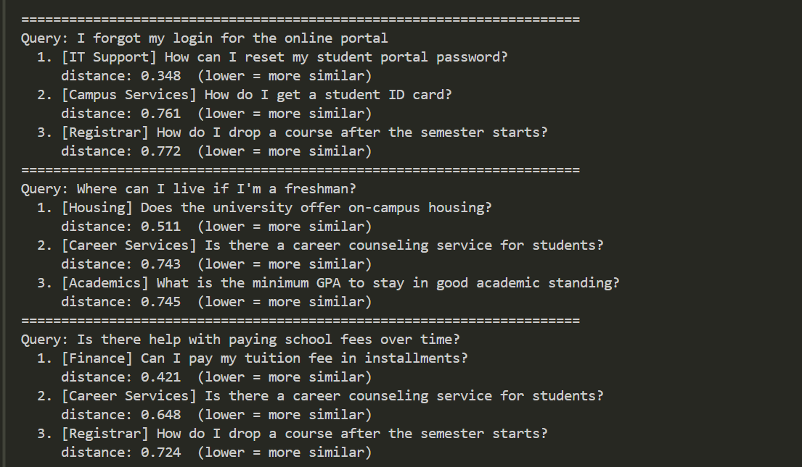
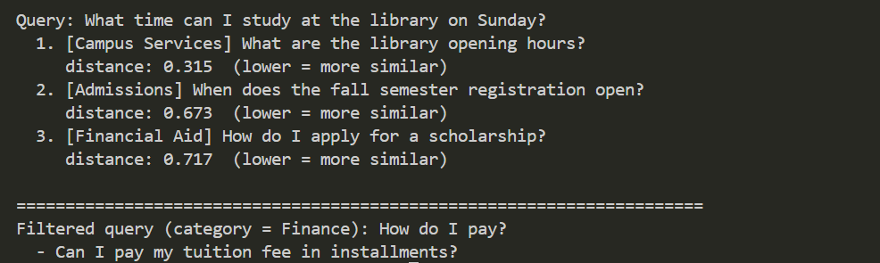

# Semantic Search with a Vector Database (Chroma)

A small semantic search system that stores university FAQs as embeddings in a local vector database and retrieves them using natural-language questions.

**Repository / source code:** `<paste your GitHub link here>` (main file: `semantic_search.py`)

## 1. Database Selected: Chroma

I chose **Chroma** because it is open source, runs locally with `pip install chromadb`, needs no account or API key, and includes a built-in embedding function (`all-MiniLM-L6-v2`). This made it the simplest way to focus on the core workflow rather than infrastructure. Records are stored in a persistent local folder (`./chroma_db`), and I configured the collection to use cosine distance.

## 2. How It Works

```
FAQ text -> embedding model -> vector -> Chroma collection -> similarity search -> relevant results
```

Each record in the collection holds three things:
- **Vector:** the embedding of the FAQ text, generated automatically by Chroma.
- **Document:** the original question and answer text.
- **Metadata:** `title`, `category` and `source`, which can be used to filter results.

## 3. Sample Information Stored (10 records)

| ID | Title | Category |
|----|-------|----------|
| faq_0 | When does the fall semester registration open? | Admissions |
| faq_1 | How do I apply for a scholarship? | Financial Aid |
| faq_2 | What are the library opening hours? | Campus Services |
| faq_3 | How can I reset my student portal password? | IT Support |
| faq_4 | Does the university offer on-campus housing? | Housing |
| faq_5 | How do I drop a course after the semester starts? | Registrar |
| faq_6 | Is there a career counseling service for students? | Career Services |
| faq_7 | What is the minimum GPA to stay in good academic standing? | Academics |
| faq_8 | How do I get a student ID card? | Campus Services |
| faq_9 | Can I pay my tuition fee in installments? | Finance |

All records use the source `University FAQ Handbook` (fictional data).

## 4. Search Queries and Results

The queries deliberately use different wording from the stored text, to test whether search works by meaning rather than keywords. Distance is cosine distance (lower = more similar).

### Query 1: "I forgot my login for the online portal"

```
1. [IT Support] How can I reset my student portal password?   distance: 0.348
2. [Campus Services] How do I get a student ID card?          distance: 0.761
3. [Registrar] How do I drop a course after the semester starts?  distance: 0.772
```

### Query 2: "Where can I live if I'm a freshman?"

```
1. [Housing] Does the university offer on-campus housing?     distance: 0.511
2. [Career Services] Is there a career counseling service for students?  distance: 0.743
3. [Academics] What is the minimum GPA to stay in good academic standing?  distance: 0.745
```

### Query 3: "Is there help with paying school fees over time?"

```
1. [Finance] Can I pay my tuition fee in installments?        distance: 0.421
2. [Career Services] Is there a career counseling service for students?  distance: 0.648
3. [Registrar] How do I drop a course after the semester starts?  distance: 0.724
```

### Query 4: "What time can I study at the library on Sunday?"

```
1. [Campus Services] What are the library opening hours?      distance: 0.315
2. [Admissions] When does the fall semester registration open?  distance: 0.673
3. [Financial Aid] How do I apply for a scholarship?          distance: 0.717
```

### Bonus: Semantic search + metadata filter
Query "How do I pay?" restricted to `category = Finance`:

```
- Can I pay my tuition fee in installments?
```

## 5. Screenshots




## 6. Review of Results

- **Meaning-based matching worked.** For all four queries the correct FAQ ranked first, even though the wording differed from the stored text: "login" matched "password", "freshman" matched the housing FAQ (which says "first-year students"), "school fees over time" matched "tuition in installments", and "study at the library" matched "library opening hours".
- **Distances show confidence.** The correct results had distances of 0.315 to 0.511, while the 2nd and 3rd results were all above 0.64. This clear gap shows the system could tell the right answer from the rest.
- **Similarity does not mean relevance.** The database always returns the requested number of results, so ranks 2 and 3 were mostly unrelated. For example, "Where can I live if I'm a freshman?" also returned the career counseling and GPA FAQs. A real application would need a distance threshold, or techniques such as re-ranking, so weak matches are not shown as answers.
- **Query 2 was the weakest top match** (0.511) because "freshman" and "live" are less direct than the words in the stored text, though it still ranked first.
- **Metadata filtering** restricted results to the Finance category and returned only the relevant record, showing how metadata can improve precision in real applications.

## 7. Real-World Relevance

This is the retrieval step of a RAG application. A company could embed its internal documents, search them when an employee asks a question, and pass the top results to an LLM to write the answer.

## 8. How to Run

```
pip install -r requirements.txt
python semantic_search.py
```

The first run downloads the embedding model (about 79 MB).
